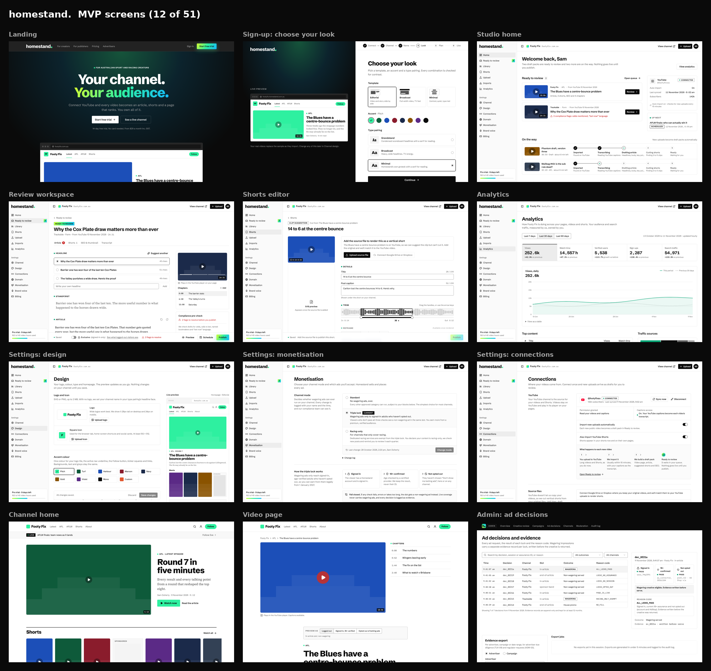

# Homestand

Video-first publishing for Australian sport, racing and lifestyle creators and publishers. Connect YouTube and every video becomes an article, shorts and a page that ranks; write an article and get the video too. One account runs several publications, sponsors take the shape of the content, and a compliant "triple lock" handles age-restricted ads from 1 January 2027. (Previously Content Base. Homestand is a working name.)

## See it

- **Design canvas, every screen in journey order:** [Homestand MVP Screens](https://claude.ai/artifact/LZsPcUteRqDAeWh4F11ym2). Press Play on any artboard and click through.
- **Brand guidelines:** [Homestand design system](https://claude.ai/artifact/CaZaHa7oNM8mt5GvUohXPV)
- **Run the app:** see below, then open `/demo` for the three click-throughs, or `/screens` for an index of all 61 screens.



## Run it

```bash
pnpm install
pnpm dev
```

Open http://localhost:3000/demo (or /screens for every screen). The app runs on fixed sample data (`apps/web/src/lib/data`); the build plan wires in the database and services.

```bash
pnpm typecheck && pnpm lint && pnpm build
```

## Docs

| Doc | What it is |
| --- | --- |
| [docs/pid.md](docs/pid.md) | Project initiation document: requirements with IDs, compliance, architecture |
| [docs/brief.md](docs/brief.md) | Marketing and product brief: audiences, promise, voice, product decisions |
| [docs/brand/](docs/brand/) | Logo files, brand book text, tokens and a shadcn/ui `globals.css` |
| [docs/screens.md](docs/screens.md) | The original screen inventory, mapped to requirement IDs |
| [docs/research/integrations.md](docs/research/integrations.md) | What YouTube, TikTok and Instagram APIs allow, and what it changes |
| [docs/build-plan.md](docs/build-plan.md) | Architecture, data model, pipelines, API surface, milestones |
| [docs/demo-clarity-plan.md](docs/demo-clarity-plan.md) | The demo plan: same-shape ads, channel calls to action, landing page, simplified journey |
| [docs/revenue-model.md](docs/revenue-model.md) | Revenue lines beyond subscriptions: ads, AI credits, triple lock licensing, data housing |

## Layout

```
apps/web     Next.js 16 + shadcn/ui: marketing, sign-up, studio, channel, account, admin
docs/        PID, brief, brand, research, build plan
```
