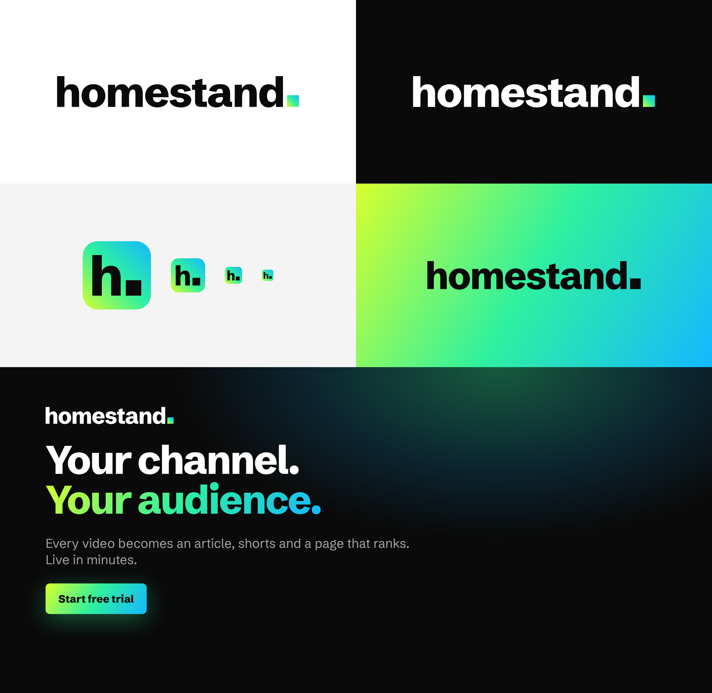

# Homestand brand

The full brand book with live components is the [Homestand design system](https://claude.ai/artifact/CaZaHa7oNM8mt5GvUohXPV). This folder is the code-side copy.

| File | What |
| --- | --- |
| `brand-guidelines.md` | The brand book text: logo, what clients can change, voice, colour, type, layout, ads, accessibility, shadcn usage |
| `tokens.json` | Every token: colours (light and dark), the Pitch gradient, type, spacing, radius, ad sizes |
| `globals.css` | The same tokens as a shadcn/ui + Tailwind v4 theme, with `bg-pitch` and `text-pitch` utilities |
| `logo/` | `homestand-wordmark.svg` (light grounds), `-reversed.svg` (black), `-mono.svg` (one colour and on Pitch), `homestand-monogram.svg` (favicon and app icon) |

**In one line:** black, white and grey do the work. Pitch (lime → mint → electric blue) is the one radiant moment, and text on it is always black.
