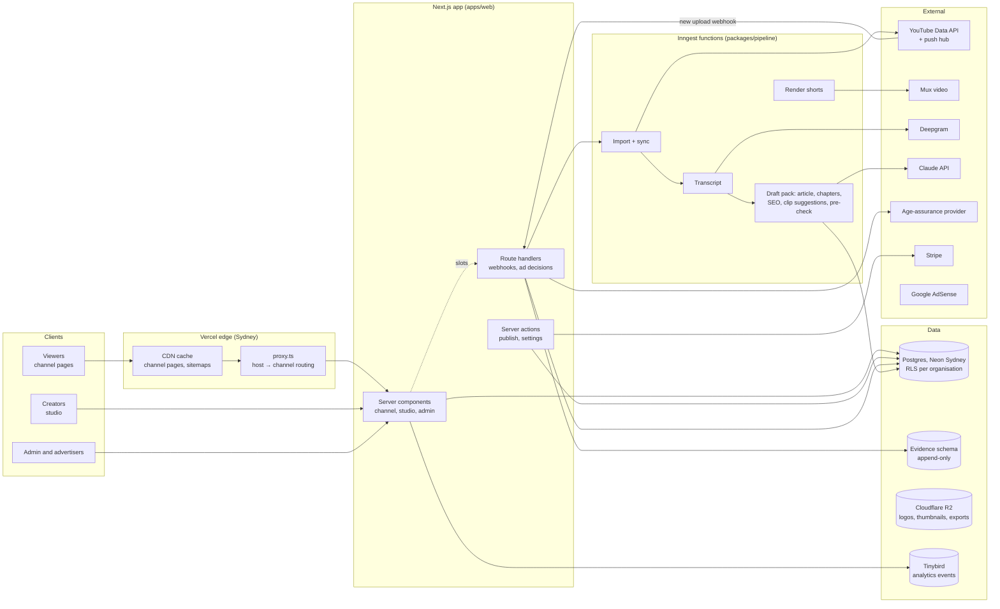
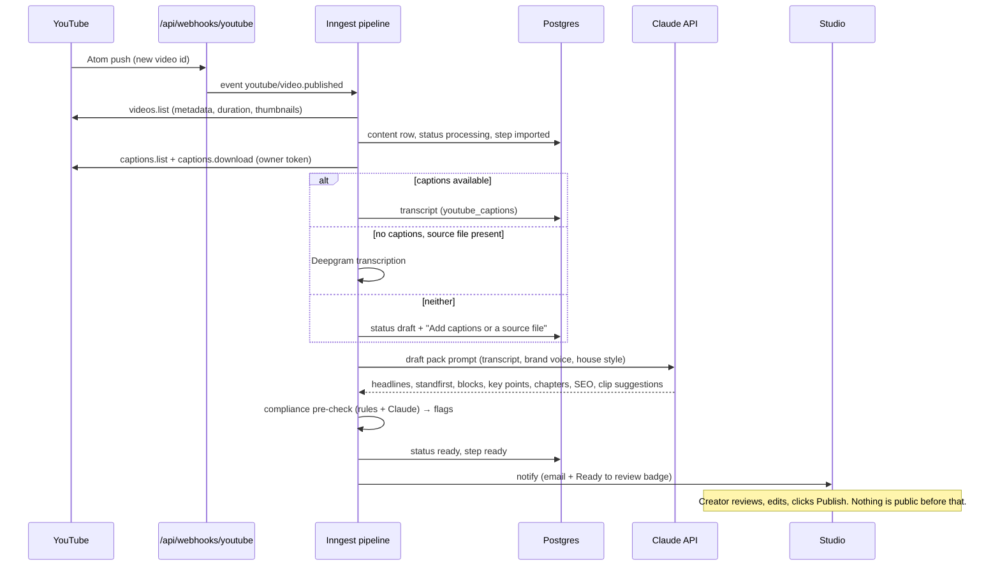

# Homestand build plan

How we take Homestand from designed screens to a working pilot. Read with the [PID](pid.md) (requirements, with IDs), the [brief](brief.md) (product decisions), the [brand guidelines](brand/brand-guidelines.md) and the [integrations research](research/integrations.md). Requirement IDs are the unit of work; every commit and PR names them.

## Where we are (11 November 2026)

| Piece | State |
| --- | --- |
| Brand | Done: homestand. wordmark, black, white and grey with the Pitch gradient, tokens, components, client customisation rules ([design system](https://claude.ai/artifact/CaZaHa7oNM8mt5GvUohXPV)) |
| Screens | Built as a working Next.js front end on sample data (`apps/web`); every route is listed at `/screens` |
| Backend | Not started. Every screen reads through `apps/web/src/lib/data`, which is the seam where the database goes in |
| Research | YouTube, TikTok and Instagram APIs checked; findings change how shorts work (see below) |

## Architecture



Request path: one Next.js app serves every surface, and the hostname picks the surface. `homestand.com.au` is marketing and sign-up, `studio.homestand.com.au` the studio, `admin.` the console, and `<channel>.homestand.com.au` or a custom domain serves the channel. `proxy.ts` (the Next.js 16 name for middleware) rewrites the host to `/c/[channel]`. Channel pages are prerendered and cached at the edge, and publishing revalidates them by tag.

Heavy work runs as Inngest functions. They retry, fan out and survive deploys, so an import of 2,000 posts or a 3-hour video never blocks a request.

Ads: every slot asks `/api/ads/decide`. That route is the only code path that can return wagering creative. It checks the triple lock and writes evidence **before** returning creative, and fails closed.

## Stack

| Layer | Choice | Why |
| --- | --- | --- |
| Monorepo | pnpm workspaces (Turborepo when there's more than one app) | One repo, shared UI and types |
| Web | Next.js 16 App Router, React 19, Cache Components, TypeScript strict | Server rendering for SEO; one app for every surface; tag-based revalidation on publish |
| UI | shadcn/ui (Radix) on Tailwind v4, Lucide icons | Themed from the brand tokens 1:1 |
| Database | Postgres on Neon (aws-ap-southeast-2), Drizzle ORM and migrations, row-level security | Data stays in Australia; branching for previews; RLS for tenancy |
| Auth | Better Auth: creators (Google, email magic link, MFA for admins) and viewers (magic link, Google, Apple) | One viewer identity across every channel, in our own database |
| Jobs | Inngest | Durable steps, retries, cron (push renewals, nightly evidence export) |
| Video | Mux for uploads (resumable upload, HLS, thumbnails, clipping) plus a render worker (ffmpeg) for 9:16 reframing and burned-in captions; YouTube IFrame player for YouTube-sourced videos | YouTube video can't be re-hosted (see research) |
| Speech-to-text | YouTube captions first; Deepgram (word timings, speakers, en-AU) for uploads and as the fallback | Cheapest and fastest path for most videos |
| LLM | Claude API | Article drafts, headlines, chapters, SEO, clip suggestions, rewrites, compliance pre-check |
| Files | Cloudflare R2 | Logos, generated thumbnails, evidence exports |
| Analytics | First-party events into Tinybird | Fast dashboards, no third-party trackers |
| Payments | Stripe Billing (AUD, GST via Stripe Tax), Stripe Connect later | Tiers, trials, invoices |
| Age assurance | A certified provider behind an interface (shortlist in milestone 6) | We never handle ID documents |
| Email | Resend | Magic links, digests, notices |
| Hosting | Vercel (Sydney functions) | Edge cache, preview deployments |
| Observability | OpenTelemetry → Axiom or Datadog; Sentry for errors | Alerts on ad-decision errors and pipeline backlog |

Every external provider sits behind an interface in `packages/providers` with a fake for tests: `VideoHost`, `SpeechToText`, `Llm`, `AgeAssurance`, `Payments`, `YouTubeSource`.

## Repo layout

```
apps/web                  Next.js app (built): marketing, auth, studio, channel, account, admin
  src/app/(marketing)     landing, publishers, pricing, advertisers
  src/app/(auth)          sign-in and the YouTube-first sign-up flow
  src/app/studio          dashboard, review, library, shorts, upload, imports, analytics, settings
  src/app/c/[channel]     public channel pages (rewritten from the channel's host)
  src/app/account         viewer account centre, age assurance
  src/app/admin           creative review, campaigns, evidence, channels, moderation, audit
  src/app/api             (to build) webhooks, ad decisions, uploads
  src/lib/data            data access: today sample data, next Drizzle queries
packages/db               (to build) Drizzle schema, migrations, RLS policies, seed
packages/pipeline         (to build) Inngest functions
packages/ads              (to build) ad decision service, triple lock, evidence writer
packages/providers        (to build) provider interfaces and fakes
docs/                     PID, brief, brand, screens, research, this plan
```

## Data model

Tenant tables carry `org_id` and have an RLS policy `org_id = current_setting('app.org_id')`. Viewer data is global (one identity across channels). Evidence lives in its own schema, where the app role has `INSERT` and `SELECT` only.

| Table | Key columns | Notes |
| --- | --- | --- |
| `organisations` | id, name, plan, stripe_customer_id, trial_ends_at | Billing owner |
| `users` | id, email, name, mfa | Creators and staff |
| `memberships` | org_id, user_id, role (owner, editor, contributor) | Team roles are Next (EDT-07); owner only in MVP |
| `channels` | id, org_id, slug, name, tagline, custom_domain, template, pairing, accent, accent_custom_hex, mode, notable_person_flag, ad_category_blocks[], adsense_enabled, modules jsonb, nav jsonb, voice jsonb, timezone | CHN-01–07, ADS-09, ING-09 |
| `domains` | channel_id, hostname, status (pending, verified, live), dns_records jsonb, ssl_status, verified_at | MIG-06; via the Vercel Domains API |
| `connections` | channel_id, provider (youtube, google_drive…), external_id, handle, scopes[], token_ref, auto_import, push_lease_expires_at, last_synced_at | Tokens are encrypted, in the vault, never in rows |
| `media_assets` | id, channel_id, source (youtube, upload), youtube_video_id, mux_asset_id, duration_sec, status, poster_url, has_source_file | One per video |
| `transcripts` | asset_id, source (youtube_captions, deepgram), language, words jsonb (start, end, speaker), text tsvector | SEO-06, search |
| `content` | id, channel_id, type (video, short, article), asset_id, status (processing, ready, draft, scheduled, published, failed), pipeline_step, title, slug, section, body jsonb (blocks), headline_options[], standfirst, key_points[], chapters jsonb, seo jsonb, exclusive, is_live, scheduled_for, published_at, canonical_url | The draft pack is one video row plus its article body and child shorts |
| `clips` | id, content_id (the short), parent_asset_id, start_sec, end_sec, crop jsonb, caption, render_status, mux_asset_id | Clip suggestions, then rendered shorts |
| `compliance_flags` | content_id, kind (odds, bet_cta, bookmaker, bet_now), block_index, excerpt, status (open, fixed, dismissed), resolved_by | ING-10 |
| `redirects` | channel_id, from_path, to_content_id, status_code | MIG-05 |
| `import_jobs` | id, channel_id, source, status, counts jsonb, problems jsonb, started_at | MIG-07 |
| `viewers` | id, email, providers[], created_at | AUD-01 |
| `follows` | viewer_id, channel_id, digest | AUD-02 |
| `age_assurances` | viewer_id, provider, method, result, provider_ref, assured_at, expires_at | TLK-02; no documents |
| `ad_preferences` | viewer_id, wagering_opt_out, source (account, ad_unit, adstop), updated_at | TLK-03, TLK-04 |
| `advertisers`, `campaigns`, `creatives` | as in PID 9; creatives hold review_status, reviewer, reasons, checklist jsonb | ADS-04–06 |
| `ad_decisions` | id, at, channel_id, page, slot, creative_id, outcome, reason_codes[] | Every request |
| `evidence.compliance_evidence` | decision_id, lock1_session_ref, lock2_assurance_ref, lock3_optout_state, adstop_checked, at | TLK-05; append-only, exported nightly to R2 (object lock) |
| `audit_log` | actor, action, target, before jsonb, after jsonb, reason, at | ADM-01; append-only |
| `reports` | content_id, viewer_id, reason, status, actioned_by | ADM-04 |

## Pipelines

### YouTube auto-import (the core loop)



- Initial import uses `playlistItems.list` on the uploads playlist (1 unit per 50 videos), never `search.list`.
- The push subscription is renewed by a daily cron. A daily `playlistItems` poll catches anything the push missed.
- Every step is idempotent, keyed on the YouTube video ID. Title and description edits re-sync metadata, but never overwrite the creator's article.
- Quota: about 251 units a new video. Apply for the YouTube compliance audit before the pilot; queue first imports across days until it's approved.

### Upload

The browser uploads straight to Mux using a direct upload URL, resumable. The Mux `video.asset.ready` webhook starts Deepgram transcription and then the same draft-pack step. Clips render with Mux clipping plus the render worker (9:16 reframe, burned-in captions). Our non-wagering pre-roll can run on these videos.

### Publish

A server action checks the creator's role, sets `published` (or `scheduled`, picked up by an Inngest cron at `scheduled_for` in the channel time zone) and writes the audit log. It then calls `revalidateTag('channel:<id>')` and `revalidateTag('content:<id>')`, regenerates the sitemaps and pings IndexNow.

### Ad decision (wagering-capable)

1. A slot calls `POST /api/ads/decide` with channel, page, slot and the session cookie.
2. If the category is blocked, the channel mode isn't triple_lock or racing_only, or the page `is_live`, wagering is excluded.
3. Lock 1: valid viewer session. Lock 2: current 18+ assurance. Lock 3: not opted out (account and AdStop adapter). Every check has a 150 ms timeout.
4. All pass, so eligible wagering creative may compete. Any failure or timeout means non-wagering only (fail closed).
5. Write `ad_decisions` and, for wagering, `evidence.compliance_evidence` in the same transaction before returning creative. If the write fails, return non-wagering.
6. The slot renders in a reserved box, labelled, with the opt-out link on wagering units.

## API surface

| Route | Kind | Purpose | IDs |
| --- | --- | --- | --- |
| `/api/auth/*` | Better Auth | Creator and viewer sign-in, OAuth callbacks (Google with YouTube scopes) | AUD-01 |
| `/api/webhooks/youtube` | GET (hub challenge) + POST (Atom) | New-upload push | MIG-01 |
| `/api/webhooks/mux` | POST, signed | Upload and asset events | ING-01–02 |
| `/api/webhooks/stripe` | POST, signed | Subscriptions, invoices | BIL-01 |
| `/api/inngest` | Inngest handler | All pipeline functions | ING, MIG |
| `/api/uploads` | POST | Create a Mux direct-upload URL | ING-01 |
| `/api/ads/decide` | POST | Ad decision service | ADS, TLK |
| `/api/ads/optout` | POST | One-tap opt-out from an ad unit | TLK-03 |
| `/api/age/callback` | GET/POST | Age-assurance provider result | TLK-02 |
| `/api/exports/evidence` | POST | Queue a CSV/PDF evidence export | ADM-03, TLK-09 |
| `/sitemap.xml`, `/video-sitemap.xml`, `/news-sitemap.xml`, `/robots.txt` | Per channel host | SEO-03 |
| Server actions | colocated with studio, settings and admin pages | Publish, schedule, save settings, review creative, takedown | EDT, CHN, ADM |

## Environment and secrets

Stored in Vercel and Inngest, never in code: `DATABASE_URL`, `BETTER_AUTH_SECRET`, `GOOGLE_CLIENT_ID/SECRET`, `APPLE_*`, `YOUTUBE_API_KEY`, `MUX_TOKEN_ID/SECRET`, `MUX_WEBHOOK_SECRET`, `DEEPGRAM_API_KEY`, `ANTHROPIC_API_KEY`, `INNGEST_EVENT_KEY/SIGNING_KEY`, `STRIPE_SECRET_KEY`, `STRIPE_WEBHOOK_SECRET`, `R2_*`, `TINYBIRD_TOKEN`, `RESEND_API_KEY`, `AGE_PROVIDER_*`, `VERCEL_API_TOKEN` (custom domains).

## Milestones

The front end exists, so each milestone wires real data and services into screens that are already designed. Each ends with something clickable on staging.

| # | Milestone | Requirement IDs | Done when | Target |
| --- | --- | --- | --- | --- |
| 0 | Spikes (1 week) | — | Proven: owner caption download incl. auto-captions; push webhook round trip; Mux clip + 9:16 render; a Claude draft-pack prompt producing article-quality output on 5 real transcripts | 20 Nov 2026 |
| 1 | Foundations | — | `packages/db` with schema, migrations, RLS and tests; Better Auth for creators; staging and prod in Sydney; CI (typecheck, lint, tests, Playwright smoke); `lib/data` reading Postgres via the seed | 11 Dec 2026 |
| 2 | YouTube-first sign-up and import | CHN-01, MIG-01, MIG-07 | Sign up with Google, pick a channel, live subdomain within 1 minute, all public videos imported with progress | 22 Jan 2027 |
| 3 | Draft packs | ING-03–11, MIG-08 | A new YouTube upload becomes a Ready-to-review pack automatically: transcript, article, chapters, SEO, clip suggestions, compliance flags | 12 Feb 2027 |
| 4 | Review, publish and channel pages | EDT-01–06, CHN-02–07, SEO-01–07 | Edit in the review workspace, publish, the page goes live on the subdomain and custom domain, sitemaps update within 5 minutes, Lighthouse SEO ≥ 95 | 5 Mar 2027 |
| 5 | Uploads and shorts | ING-01, ING-02, ING-07, EDT-06 | Upload with resume; shorts render from uploads and from matched source files; YouTube Shorts imported as embeds | 19 Mar 2027 |
| 6 | Site migration | MIG-02–06 | WordPress, Ghost, Substack and RSS import with 301 maps and a clean crawl report | 2 Apr 2027 |
| 7 | Viewers, ads and the triple lock | AUD-01–04, ADS-01–09, TLK-01–10 | One viewer account; age assurance live; ad decision service with evidence; creative review; AdSense in slots; due-diligence pack | 23 Apr 2027 |
| 8 | Billing, analytics, admin, hardening | BIL-01–02, ANL-01–04, ADM-01–05, NFRs | Stripe tiers and trial; dashboards on real data; admin console; accessibility, Core Web Vitals, pen test, compliance audit | 30 Apr 2027 |

Pilot starts 3 May 2027 (Gate 1).

## Risks and spikes

| Risk | Plan |
| --- | --- |
| Auto-generated captions can't be downloaded for some videos | Spike in milestone 0. Fallback: source file plus Deepgram, and a clear prompt in the pack |
| YouTube quota too small for first imports | Compliance audit applied for in milestone 1; queue and spread caption fetches |
| Google OAuth verification delays sign-up | Submit in milestone 2 with a demo video; pilot runs in Testing mode (up to 100 users) |
| Shorts from YouTube-only creators feel weaker | Clip suggestions with one-tap "Add source file"; Google Drive matching in "Now" |
| AI article quality judged low-value by Google | Human review gate; brand voice; editorial quality bar; Search Console watched in the pilot |
| Triple-lock failure | Fail closed; evidence written before serve; end-to-end tests; alert on any wagering impression without full evidence |

## Decisions needed

| Decision | Blocks | Owner |
| --- | --- | --- |
| Approve this stack | Milestone 1 | Dan |
| Age-assurance provider | Milestone 7 (TLK-02) | Dan + counsel |
| Evidence retention (12 months minimum, 7 years recommended) | Milestone 7 (TLK-05) | Counsel |
| Wagering CPC allowed? | Milestone 7 (ADS-05) | Counsel |
| Ad density caps (1 per 600 words, 3 a page) | Milestone 7 | Dan |
| Trial needs a card or not | Milestone 8 | Dan |
| Final product name and domain | Launch | Dan |

## Hard rules (from the PID)

- Never serve a wagering ad without all three locks. Fail closed on any error.
- Never price anything on sign-ups, deposits or bets.
- Never let a creator contract directly with a wagering advertiser through the platform.
- Never auto-publish AI-generated content.
- Never store identity documents.
